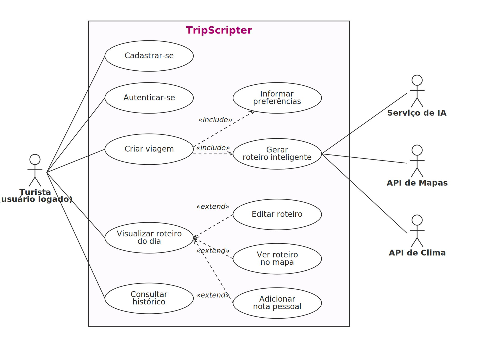
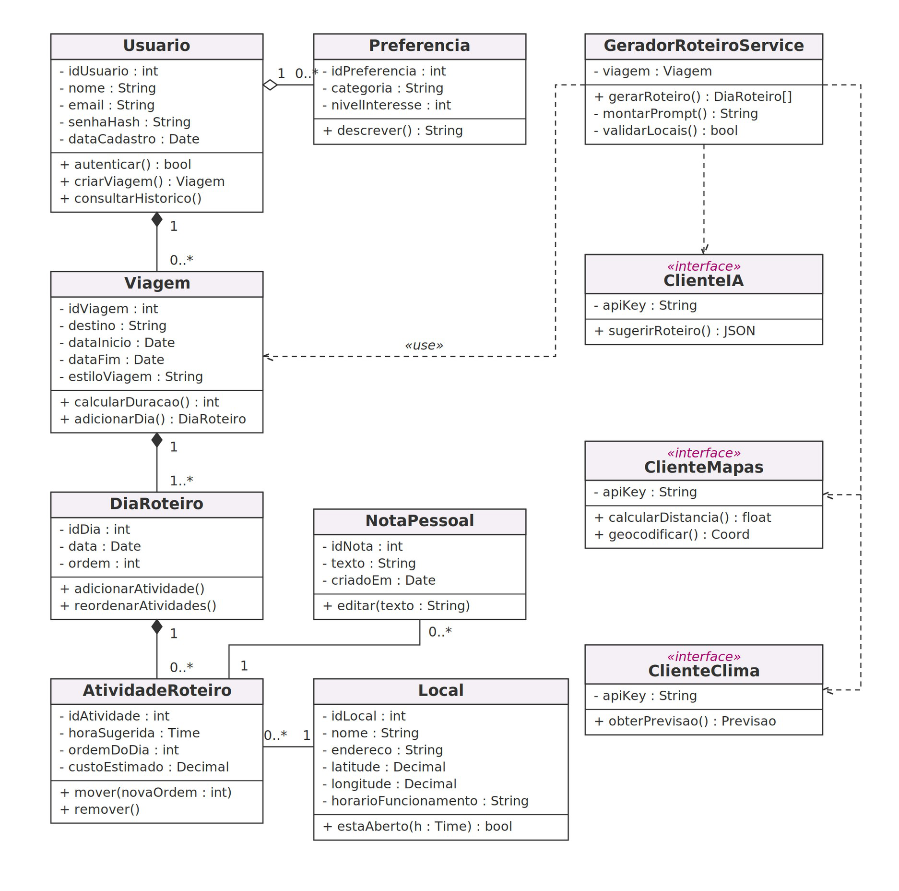
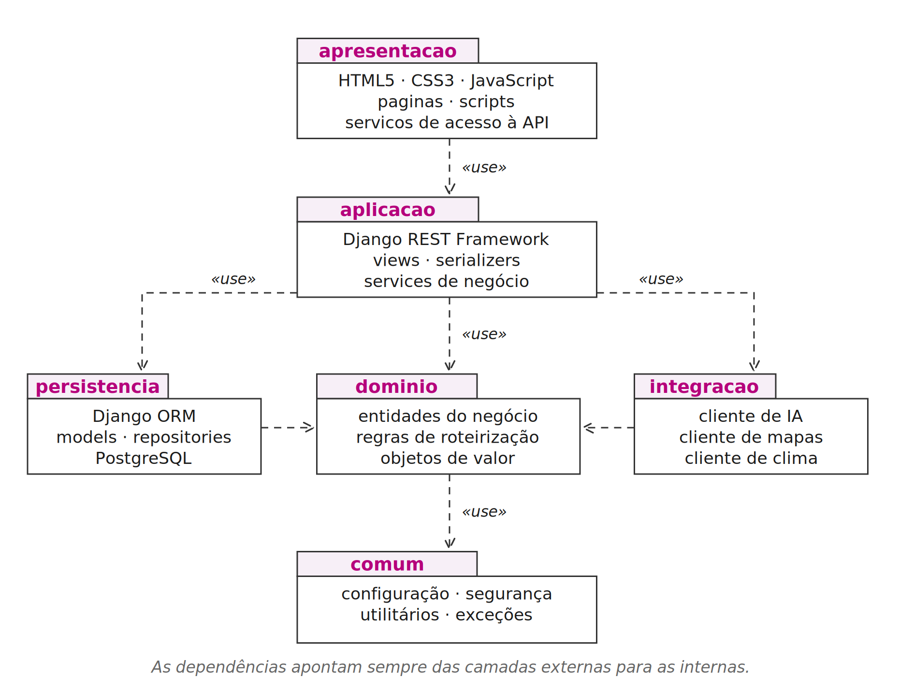
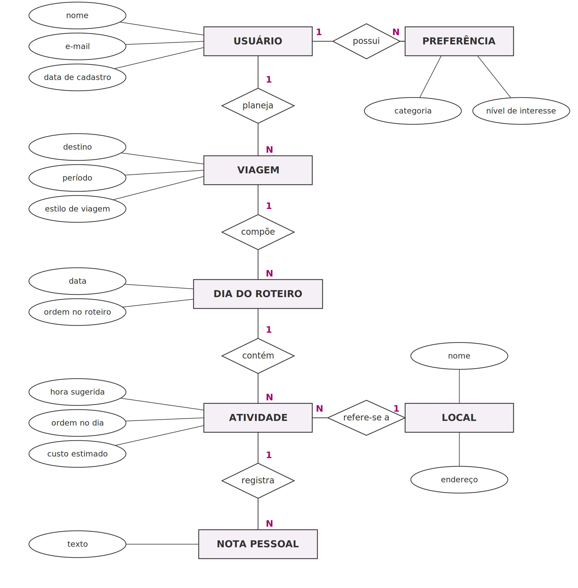
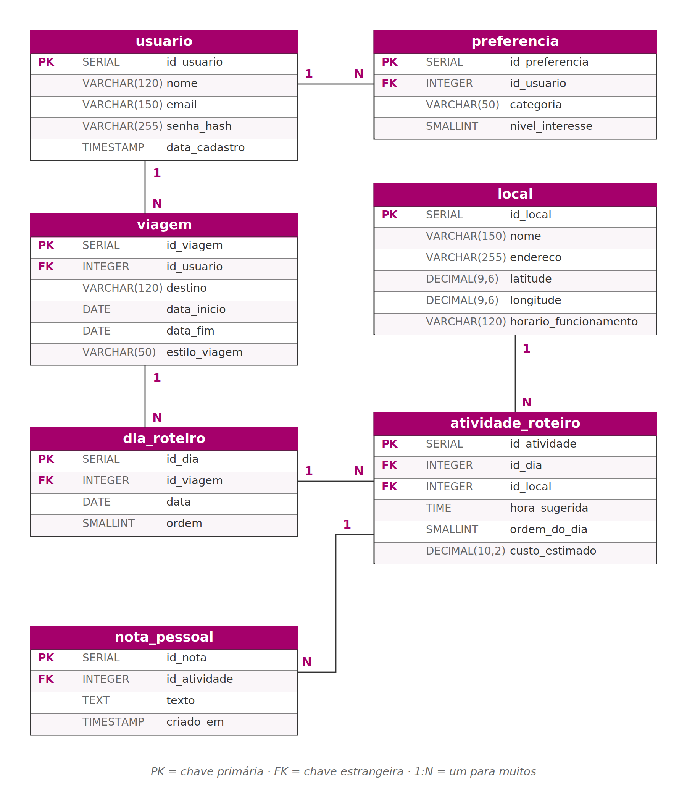

# Documento de Arquitetura de Software

Projeto: **TripScripter** — plataforma web de planejamento de roteiros de viagem apoiada por inteligência artificial.
Disciplina: Projeto Integrador I — Análise e Desenvolvimento de Sistemas, CEUB.
Orientador: Prof. Valdemir S. Silva.

Autores: Diogo Heberth de Sousa Silva, Fernando Machado de Faria, Matheus Sousa Costa, Victor Hugo Américo Dos Santos Garajau.

> Versão em Markdown do documento entregue à disciplina. A versão oficial em PDF, formatada conforme as normas ABNT, está em [arquitetura.pdf](arquitetura.pdf).

## 1 INTRODUÇÃO

Este documento descreve a arquitetura de software do TripScripter, plataforma web de planejamento de roteiros de viagem apoiada por inteligência artificial, desenvolvida como Projeto Integrador I do curso de Análise e Desenvolvimento de Sistemas do CEUB.

Enquanto a Declaração de Escopo define o que será construído e o Documento de Requisitos define o comportamento esperado do sistema, este documento registra como o software será estruturado internamente, apresentando o padrão de desenvolvimento adotado, a metodologia de trabalho da equipe, a modelagem em UML e os modelos de dados. A estrutura segue as recomendações de Pressman e Maxim (2016) e de Sommerville (2019) para documentos de projeto de software.

### 1.1 Objetivo deste documento

O objetivo é registrar e justificar as decisões técnicas do projeto, de modo que qualquer integrante da equipe — ou um desenvolvedor que venha a assumir o sistema posteriormente — consiga compreender a organização interna do software antes de escrever código.

São objetivos específicos deste documento:

> a) declarar o padrão arquitetural e os padrões de projeto adotados;
>
> b) formalizar a metodologia de desenvolvimento e o roadmap das entregas;
>
> c) apresentar os diagramas de casos de uso, de classes e de pacotes;
>
> d) apresentar os modelos de dados conceitual e físico.

### 1.2 Escopo deste documento

Este documento abrange a versão de produto mínimo viável (MVP) do TripScripter, entregue como aplicação web. Não fazem parte deste documento o plano detalhado de testes, o manual do usuário e a política de segurança da informação, tratados em documentos próprios do projeto.

Optou-se por limitar esta versão à aplicação web. O acesso por dispositivos móveis ocorre pelo navegador, por meio de interface responsiva, atendendo ao previsto na Declaração de Escopo quanto ao uso do sistema em computador ou celular. O aplicativo móvel nativo não integra o MVP e está previsto para etapa posterior do projeto, quando poderá ser construído sobre a mesma API REST, sem alteração no servidor.

### 1.3 Visão geral do sistema

O TripScripter permite que o usuário informe o destino, o período da viagem e suas preferências de atividades — como gastronomia, cultura, natureza e lazer — e receba automaticamente um roteiro organizado por dias, que pode ser visualizado em lista ou em mapa, editado e complementado com notas pessoais.

Para produzir o roteiro, o sistema combina três serviços externos: um serviço de inteligência artificial, responsável por sugerir a composição das atividades; um serviço de mapas, responsável pela geolocalização e pelo cálculo de distâncias entre atrações; e um serviço de previsão do tempo, que permite priorizar locais fechados em dias de chuva. Essa dependência de terceiros é determinante para as decisões arquiteturais descritas na seção 2.

## 2 PADRÃO DE DESENVOLVIMENTO DE SOFTWARE

Esta seção apresenta o padrão arquitetural adotado no TripScripter, os padrões de projeto que o complementam, a relação entre ambos e as tecnologias associadas a cada camada.

### 2.1 Padrão arquitetural adotado

O TripScripter adota a arquitetura em camadas (layered architecture), organizada no estilo cliente-servidor, com comunicação entre cliente e servidor por meio de uma API REST sobre HTTPS, utilizando JSON como formato de troca de mensagens.

A aplicação é estruturada em cinco camadas lógicas:

> a) apresentação: interface do usuário, responsável pela exibição das telas, dos formulários e dos cartões de atividade;
>
> b) aplicação: recebe as requisições, valida os dados de entrada e orquestra a execução dos casos de uso;
>
> c) domínio: concentra as regras de negócio do sistema, como a obrigatoriedade de distribuir as atividades ao longo dos dias da viagem;
>
> d) persistência: realiza o mapeamento objeto-relacional e o acesso ao banco de dados;
>
> e) integração: encapsula o consumo dos serviços externos de inteligência artificial, mapas e previsão do tempo.

A regra de dependência é unidirecional: as camadas mais externas dependem das mais internas, nunca o contrário. A camada de domínio, por concentrar as regras de negócio, não conhece framework, banco de dados nem provedor externo, o que a torna a parte mais estável e mais facilmente testável do sistema.

Optou-se por um monólito modular, e não por microsserviços. A justificativa é direta: a equipe é composta por quatro estudantes, o prazo é o do calendário acadêmico e a infraestrutura disponível é gratuita. Nesse cenário, o custo operacional de múltiplos serviços independentes superaria os benefícios, conforme adverte Fowler (2006) ao tratar da escolha de padrões de arquitetura corporativa.

### 2.2 Padrões de projeto

No servidor, o framework Django organiza o código segundo o padrão MVT (Model–View–Template), variação do clássico MVC (Model–View–Controller). Como a apresentação do TripScripter é responsabilidade de uma aplicação cliente independente, executada no navegador, a camada de Template não é utilizada: seu papel é assumido pelos serializers do Django REST Framework, que convertem os objetos de domínio em JSON.

Complementam a arquitetura os seguintes padrões:

> a) Service Layer: a classe GeradorRoteiroService concentra a lógica de geração do roteiro, evitando que essa responsabilidade se espalhe pelas views;
>
> b) Adapter (ou Gateway): as interfaces ClienteIA, ClienteMapas e ClienteClima isolam o restante do sistema dos provedores externos;
>
> c) Repository: implementado por meio do Django ORM, abstrai o acesso ao banco de dados;
>
> d) DTO (Data Transfer Object): os serializers atuam como objetos de transferência entre a API e o cliente.

O padrão Adapter merece destaque porque atende diretamente a um risco já mapeado pela equipe: a possibilidade de os custos das APIs de mapas ou de inteligência artificial excederem os planos gratuitos. Com a integração isolada atrás de uma interface, a substituição do provedor — por exemplo, a migração do Google Maps para o OpenStreetMap — exige apenas uma nova implementação da interface, sem alteração nas demais camadas.

### 2.3 Relação entre a arquitetura em camadas e o padrão MVC

A presença simultânea da arquitetura em camadas e do padrão MVC no projeto não constitui sobreposição nem contradição: trata-se de decisões tomadas em níveis de abstração distintos, conforme distinguem Buschmann et al. (1996) ao separar padrões arquiteturais de padrões de projeto.

A **arquitetura em camadas** é uma decisão de nível macro. Ela determina em quantos blocos de responsabilidade o sistema se divide, onde cada bloco é executado e quais comunicações são permitidas entre eles. No TripScripter, é o que estabelece que o cliente jamais acessa o banco de dados diretamente, e que toda informação trafega pela API REST.

O **padrão MVC**, por sua vez, é uma decisão de nível micro. Ele não divide o sistema: organiza internamente o código de uma camada específica — no caso, a camada de aplicação —, separando a representação dos dados, a lógica que responde às requisições e a forma como a informação é apresentada. Formulado originalmente por Krasner e Pope (1988) para interfaces gráficas em Smalltalk, o padrão foi posteriormente incorporado por frameworks web, entre eles o Django.

Em síntese: a arquitetura em camadas define ***onde*** cada parte do sistema é executada; o padrão MVC define ***como*** o código está organizado dentro de uma dessas partes.

O Quadro 1 apresenta a correspondência entre os componentes do MVC clássico, a nomenclatura adotada pelo Django e a implementação efetiva no TripScripter.

Quadro 1 – Correspondência entre MVC, MVT e a implementação do TripScripter

| **MVC clássico** | **Django (MVT)** | **Implementação no TripScripter**                                                                     | **Camada correspondente** |
|------------------|------------------|-------------------------------------------------------------------------------------------------------|---------------------------|
| Model            | Model            | models.py — entidades Usuario, Viagem, DiaRoteiro, AtividadeRoteiro, Local, Preferencia e NotaPessoal | Domínio e Persistência    |
| Controller       | View             | views.py e ViewSets do Django REST Framework                                                          | Aplicação                 |
| View             | Template         | Não utilizado. Substituído pelos serializers, que produzem JSON, e pelas páginas HTML do cliente      | Apresentação              |

Fonte: elaborado pelos autores (2026).

Cabe registrar que a camada de Template do Django permanece deliberadamente inativa. Por se tratar de uma arquitetura cliente-servidor com API REST, a renderização das telas é responsabilidade exclusiva do cliente, executado no navegador. O servidor Django atua unicamente como provedor de dados serializados. Essa separação favorece o desacoplamento entre interface e regra de negócio e viabiliza que outros clientes — por exemplo, um aplicativo móvel em versões futuras — sejam construídos sobre a mesma API, sem qualquer alteração no servidor.

### 2.4 Tecnologias por camada

O Quadro 2 relaciona cada camada da arquitetura às tecnologias adotadas e às respectivas responsabilidades.

Quadro 2 – Tecnologias adotadas por camada

| **Camada**     | **Tecnologia**                                   | **Responsabilidade**                                                         |
|----------------|--------------------------------------------------|------------------------------------------------------------------------------|
| Apresentação   | HTML5, CSS3 e JavaScript (ES6+)                  | Renderizar telas, formulários, cartões de atividade e a visualização em mapa |
| Aplicação      | Django e Django REST Framework                   | Expor os endpoints REST, validar entradas e orquestrar os casos de uso       |
| Domínio        | Python                                           | Concentrar as regras de negócio da roteirização                              |
| Persistência   | Django ORM e PostgreSQL                          | Mapear objetos em tabelas, controlar transações e integridade referencial    |
| Integração     | Clientes HTTP para serviços de IA, mapas e clima | Encapsular o consumo das APIs externas                                       |
| Infraestrutura | Git e GitHub                                     | Controle de versão e integração do trabalho da equipe                        |

Fonte: elaborado pelos autores (2026).

O Quadro 3 detalha as linguagens, os frameworks e as versões efetivamente adotados, atendendo à necessidade de explicitar as escolhas tecnológicas do projeto.

Quadro 3 – Linguagens, frameworks e versões

| **Item**            | **Linguagem**                   | **Framework / Ferramenta** | **Versão**            |
|---------------------|---------------------------------|----------------------------|-----------------------|
| Cliente (front-end) | JavaScript (ES6+), HTML5 e CSS3 | Sem framework              | —                     |
| Servidor (back-end) | Python 3.14.6                   | Django                     | 6.1.1                 |
| API REST            | Python 3.14.6                   | Django REST Framework      | 3.18.0                |
| Banco de dados      | SQL                             | PostgreSQL                 | A definir na Sprint 2 |
| Controle de versão  | —                               | Git e GitHub               | —                     |

Fonte: elaborado pelos autores (2026).

O front-end é implementado em JavaScript puro, sem framework. A decisão foi tomada em função das restrições registradas na seção 2.5: a adoção de um framework como React ou Vue implicaria uma curva de aprendizado estimada em ao menos uma Sprint completa, consumindo tempo de um cronograma já limitado pelo calendário acadêmico. As telas do MVP — autenticação, listagem de viagens e visualização do roteiro diário — não apresentam complexidade de estado que justifique esse custo. Trata-se, portanto, de uma escolha orientada pelas restrições do projeto, conforme recomendam Pressman e Maxim (2016) ao tratar da seleção de tecnologias em contextos de recursos limitados. A interface é construída de forma responsiva, adaptando-se a telas de computador e de dispositivos móveis. A adoção de um framework de interface permanece registrada como possibilidade para versões posteriores, sem impacto sobre o servidor, uma vez que a comunicação já ocorre por API REST.

A escolha por PostgreSQL, em detrimento de bancos não relacionais, decorre da natureza fortemente relacional dos dados do sistema: um usuário possui viagens, que se compõem de dias, que contêm atividades vinculadas a locais. A integridade referencial entre essas entidades é requisito para que o roteiro permaneça consistente após as edições feitas pelo usuário.

### 2.5 Restrições arquiteturais

As decisões descritas nesta seção foram condicionadas pelas seguintes restrições, já registradas na Declaração de Escopo do projeto:

> a) prazo limitado ao calendário acadêmico;
>
> b) equipe reduzida, composta por quatro estudantes;
>
> c) recursos financeiros escassos, com uso exclusivo de ferramentas gratuitas ou de código aberto;
>
> d) dependência dos planos gratuitos oferecidos pelos provedores das APIs externas;
>
> e) experiência prévia limitada da equipe com frameworks de interface, o que orientou a opção por tecnologias web fundamentais no cliente.

## 3 METODOLOGIA DE DESENVOLVIMENTO E ROADMAP

### 3.1 Metodologia adotada

A metodologia de desenvolvimento adotada no TripScripter é o Scrum, framework ágil descrito por Schwaber e Sutherland (2020), organizado em iterações de duração fixa denominadas Sprints. Definiu-se a duração de duas semanas por Sprint, compatível com o calendário da disciplina.

A escolha do Scrum decorre de duas características do projeto. Primeiro, os requisitos do sistema dependem de validação com usuários reais, e o Scrum prevê entregas incrementais que viabilizam essa validação a cada iteração. Segundo, o projeto depende de serviços externos cujo comportamento não é totalmente conhecido de antemão, o que exige capacidade de adaptação ao longo do desenvolvimento.

### 3.2 Papéis e responsabilidades

O Quadro 4 apresenta os papéis previstos pelo Scrum, sua atribuição no contexto do projeto e os integrantes responsáveis.

Quadro 4 – Papéis do Scrum no projeto

| **Papel**                 | **Integrante**                                                                                                        | **Responsabilidade**                                                                                                                        |
|---------------------------|-----------------------------------------------------------------------------------------------------------------------|---------------------------------------------------------------------------------------------------------------------------------------------|
| Product Owner             | Matheus Sousa Costa                                                                                                   | Manter e priorizar o Product Backlog, representar o interesse do usuário final e dar o aceite nas entregas de cada Sprint                   |
| Scrum Master              | Victor Hugo Américo Dos Santos Garajau                                                                                | Facilitar as cerimônias, remover impedimentos técnicos e garantir a aplicação do framework                                                  |
| Equipe de Desenvolvimento | Diogo Heberth de Sousa Silva, Fernando Machado de Faria, Matheus Sousa Costa e Victor Hugo Américo Dos Santos Garajau | Estimar o esforço das tarefas, implementar as funcionalidades e garantir os padrões de qualidade e de arquitetura definidos neste documento |
| Stakeholders              | Corpo docente, avaliadores e usuários potenciais                                                                      | Fornecer feedback e validar a utilidade do sistema                                                                                          |

Fonte: elaborado pelos autores (2026).

Cabe registrar que os quatro integrantes compõem simultaneamente a Equipe de Desenvolvimento, inclusive aqueles que respondem pelo Product Owner e pelo Scrum Master. Trata-se de acúmulo de papéis motivado pela dimensão reduzida da equipe, prática comum em projetos acadêmicos e admitida pelo Guia do Scrum (SCHWABER; SUTHERLAND, 2020), que define responsabilidades e não cargos exclusivos.

### 3.3 Cerimônias e artefatos

São adotadas as seguintes cerimônias: Sprint Planning, na qual a equipe seleciona os itens do backlog para a iteração; Daily Scrum, reunião breve de alinhamento; Sprint Review, na qual o incremento é apresentado; e Sprint Retrospective, destinada à melhoria do processo de trabalho.

Os artefatos mantidos são o Product Backlog, o Sprint Backlog, o Incremento e a Definição de Pronto (Definition of Done), esta última estabelecida para impedir que código com defeitos conhecidos seja considerado entregue.

### 3.4 Roadmap de desenvolvimento

O Quadro 5 apresenta o roadmap do MVP, distribuído em seis Sprints de duas semanas, totalizando doze semanas de desenvolvimento. A ordem das entregas respeita a classificação de prioridade estabelecida no Documento de Requisitos — Essencial, Importante e Desejável: os itens classificados como Essenciais são entregues nas primeiras Sprints, por sustentarem o fluxo principal do sistema.

Quadro 5 – Roadmap de desenvolvimento do MVP

| **Sprint** | **Semanas** | **Entrega principal**                                            | **Requisitos atendidos** |
|------------|-------------|------------------------------------------------------------------|--------------------------|
| 1          | 1 e 2       | Cadastro e autenticação de usuários; tela de criação de viagem   | RQ001, RQ002             |
| 2          | 3 e 4       | Modelagem do banco de dados e API REST de viagens e preferências | RQ003                    |
| 3          | 5 e 6       | Integração com o serviço de IA e geração automática do roteiro   | RQ004                    |
| 4          | 7 e 8       | Organização das atividades por dia e visualização em lista       | RQ005                    |
| 5          | 9 e 10      | Visualização em mapa e edição do roteiro pelo usuário            | RQ006, RQ007             |
| 6          | 11 e 12     | Notas pessoais, histórico de viagens, testes e ajustes finais    | RQ008, RQ011             |

Fonte: elaborado pelos autores (2026).

### 3.5 Backlog do produto e priorização

O Product Backlog reúne, em lista única e ordenada, todo o trabalho previsto para o produto. Cada item é expresso como história de usuário, no formato que descreve o papel, a ação desejada e o benefício esperado, e mantém vínculo com o requisito que lhe deu origem no Documento de Requisitos, garantindo a rastreabilidade entre requisito, história e Sprint de entrega.

A prioridade de cada item reproduz a classificação atribuída no Documento de Requisitos: Essencial, para funcionalidades sem as quais o sistema não cumpre seu propósito; Importante, para funcionalidades que agregam valor significativo, mas cuja ausência não inviabiliza o uso; e Desejável, para funcionalidades complementares.

A estimativa de esforço é expressa em pontos de história, segundo a sequência de Fibonacci (1, 2, 3, 5, 8, 13). Trata-se de medida relativa, e não de tempo: um item de 8 pontos representa aproximadamente o dobro do esforço de um item de 5 pontos. As estimativas registradas são iniciais e revisadas pela equipe a cada Sprint Planning.

Quadro 6 – Product Backlog priorizado

| **ID** | **História de usuário**                                                                                                                                | **Requisito** | **Prioridade** | **Pontos** | **Sprint** |
|--------|--------------------------------------------------------------------------------------------------------------------------------------------------------|---------------|----------------|------------|------------|
| B01    | Como turista, quero criar uma conta informando nome, e-mail e senha, para que minhas viagens fiquem salvas no sistema                                  | RQ001         | Essencial      | 3          | 1          |
| B02    | Como usuário cadastrado, quero autenticar-me com e-mail e senha, para acessar as viagens que já criei                                                  | RQ002         | Essencial      | 3          | 1          |
| B03    | Como turista, quero cadastrar uma viagem informando destino e período, para que o sistema saiba o que planejar                                         | RQ003         | Essencial      | 5          | 1 e 2      |
| B04    | Como turista, quero selecionar minhas preferências de atividades, para que o roteiro reflita meus interesses                                           | RQ003         | Essencial      | 3          | 2          |
| B05    | Como turista, quero que o sistema gere automaticamente um roteiro a partir das minhas preferências, para não precisar pesquisar cada local manualmente | RQ004         | Essencial      | 13         | 3          |
| B06    | Como turista, quero visualizar as atividades distribuídas por dia, para compreender a sequência da viagem                                              | RQ005         | Essencial      | 8          | 4          |
| B07    | Como turista, quero ver os locais do roteiro em um mapa, para avaliar os deslocamentos entre atrações                                                  | RQ006         | Importante     | 8          | 5          |
| B08    | Como turista, quero reordenar, remover e acrescentar atividades, para ajustar o roteiro ao meu gosto                                                   | RQ007         | Importante     | 8          | 5          |
| B09    | Como turista, quero registrar notas pessoais nas atividades, para guardar lembretes sobre cada local                                                   | RQ008         | Desejável      | 3          | 6          |
| B10    | Como usuário cadastrado, quero consultar minhas viagens anteriores, para reaproveitar roteiros já criados                                              | RQ011         | Desejável      | 5          | 6          |

Fonte: elaborado pelos autores (2026).

A soma das estimativas totaliza 59 pontos distribuídos em seis Sprints, o que corresponde a uma velocidade média aproximada de 10 pontos por Sprint. A concentração de esforço na Sprint 3 decorre do item B05, que depende da integração com o serviço externo de inteligência artificial e concentra o maior grau de incerteza do projeto.

Os requisitos não funcionais RQ009, referente a desempenho, e RQ010, referente a usabilidade, não figuram como itens isolados do backlog por serem transversais a todas as histórias. São tratados como critérios da Definição de Pronto, verificados a cada entrega, o que impede que uma funcionalidade seja considerada concluída sem atender aos padrões de tempo de resposta e de facilidade de uso estabelecidos.

Registra-se ainda que o item B10 decorre do requisito RQ011, relativo ao histórico de viagens. Essa funcionalidade constava do escopo do produto e do diagrama de casos de uso, mas não havia sido formalizada como requisito no Documento de Requisitos. A lacuna foi identificada durante a elaboração deste backlog e o requisito deverá ser incorporado à próxima revisão daquele documento.

## 4 MODELAGEM UML

Esta seção apresenta a modelagem do sistema em UML (Unified Modeling Language), por meio dos diagramas de casos de uso, de classes e de pacotes.

### 4.1 Diagrama de casos de uso

O diagrama de casos de uso representa as funcionalidades do sistema sob a perspectiva de quem as utiliza. A Figura 1 apresenta os casos de uso do TripScripter.

Figura 1 – Diagrama de casos de uso do TripScripter

Fonte: elaborado pelos autores (2026).

O ator principal é o turista autenticado. As APIs de inteligência artificial, de mapas e de previsão do tempo figuram como atores secundários, pois o sistema depende delas para concluir o caso de uso Gerar roteiro inteligente.

Dois relacionamentos merecem atenção. O caso de uso Informar preferências é ligado a Criar viagem por um relacionamento de inclusão («include»), uma vez que sempre ocorre como parte da criação da viagem. Já Editar roteiro, Ver roteiro no mapa e Adicionar nota pessoal são ligados a Visualizar roteiro do dia por relacionamentos de extensão («extend»), pois ocorrem apenas por iniciativa do usuário, sem serem obrigatórios ao fluxo principal.

### 4.2 Diagrama de classes

O diagrama de classes descreve a estrutura estática do sistema, apresentando as classes, seus atributos, seus métodos e os relacionamentos entre elas. A Figura 2 apresenta as classes do TripScripter.

Figura 2 – Diagrama de classes do TripScripter

Fonte: elaborado pelos autores (2026).

As classes Usuario, Viagem, DiaRoteiro, AtividadeRoteiro, Local, Preferencia e NotaPessoal correspondem às entidades de negócio. Os losangos preenchidos indicam composição: um DiaRoteiro não existe sem a Viagem à qual pertence, assim como uma AtividadeRoteiro não existe sem o dia que a contém.

A classe GeradorRoteiroService e as interfaces ClienteIA, ClienteMapas e ClienteClima não correspondem a tabelas do banco de dados. Elas materializam, respectivamente, os padrões Service Layer e Adapter descritos na seção 2.2, e evidenciam a diferença entre o modelo de classes, que descreve comportamento, e o modelo de dados, que descreve apenas armazenamento.

### 4.3 Diagrama de pacotes

O diagrama de pacotes apresenta o agrupamento lógico dos módulos do sistema e as dependências entre eles. A Figura 3 apresenta a organização adotada.

Figura 3 – Diagrama de pacotes do TripScripter

Fonte: elaborado pelos autores (2026).

Cada pacote corresponde a uma das camadas descritas na seção 2.1. As setas tracejadas representam dependências de uso e apontam sempre das camadas externas para as internas, em conformidade com a regra de dependência unidirecional. O pacote dominio não depende de nenhum outro, o que permite testá-lo isoladamente, sem banco de dados e sem acesso à rede.

## 5 MODELOS DE DADOS

Esta seção apresenta os modelos de dados do sistema em dois níveis de abstração: o modelo conceitual, que descreve as entidades do negócio, e o modelo físico, que descreve as tabelas efetivamente implementadas no banco de dados.

### 5.1 Modelo conceitual

O modelo conceitual representa as entidades do domínio, seus atributos e os relacionamentos entre elas, sem qualquer referência a tipos de dados ou a chaves. A Figura 4 apresenta o modelo conceitual do TripScripter na notação de Peter Chen, na qual os retângulos representam entidades, os losangos representam relacionamentos e as elipses representam atributos.

Figura 4 – Modelo conceitual do TripScripter

Fonte: elaborado pelos autores (2026).

A entidade DIA DO ROTEIRO ocupa posição central no modelo. Ela existe porque o sistema deve obrigatoriamente organizar as atividades ao longo dos dias da viagem, conforme estabelecido nas regras de negócio e no requisito RQ005. Sem essa entidade intermediária, não haveria onde registrar a que dia cada atividade pertence.

A entidade LOCAL foi separada de ATIVIDADE porque o mesmo ponto turístico pode ser sugerido em viagens diferentes, de usuários diferentes. Manter o local como entidade própria evita a duplicação de endereços e coordenadas geográficas a cada roteiro gerado. Pela mesma razão, a categoria do ponto turístico (Cultura, Gastronomia, Arte, Natureza, História, Compras, Vida noturna ou Praia) é atributo de LOCAL, e não de ATIVIDADE: é uma característica do lugar, válida em qualquer roteiro em que ele apareça.

### 5.2 Modelo físico

O modelo físico apresenta as tabelas do banco de dados relacional, com seus tipos de dados, chaves primárias e chaves estrangeiras. A Figura 5 apresenta o modelo físico implementado em PostgreSQL.

Figura 5 – Modelo físico do banco de dados do TripScripter

Fonte: elaborado pelos autores (2026).

Todas as tabelas possuem chave primária própria, do tipo SERIAL, e os relacionamentos são materializados por chaves estrangeiras. As cardinalidades indicadas correspondem às do modelo conceitual apresentado na seção anterior.

A tabela preferencia foi normalizada: em vez de campos booleanos fixos para cada categoria de interesse, cada preferência do usuário é registrada como um par formado por categoria e nível de interesse. Essa decisão permite incluir novas categorias de atividade sem alterar a estrutura do banco de dados, atendendo à atividade de refinamento contínuo do backlog prevista na metodologia.

O Quadro 7 descreve a finalidade de cada tabela.

Quadro 7 – Descrição das tabelas do banco de dados

| **Tabela**        | **Finalidade**                                                                                |
|-------------------|-----------------------------------------------------------------------------------------------|
| usuario           | Armazena os dados de cadastro e as credenciais de acesso do turista                           |
| preferencia       | Registra as categorias de atividade de interesse do usuário e o respectivo nível de interesse |
| viagem            | Registra o destino, o período e o estilo de cada viagem planejada                             |
| dia_roteiro       | Representa cada dia da viagem e sua ordem dentro do roteiro                                   |
| atividade_roteiro | Registra a atividade sugerida para um dia, com horário, ordem e custo estimado                |
| local             | Catálogo de pontos turísticos, com endereço, coordenadas, horário de funcionamento e categoria |
| nota_pessoal      | Armazena as anotações privadas do usuário associadas a uma atividade                          |

Fonte: elaborado pelos autores (2026).

## 6 CONSIDERAÇÕES FINAIS

Este documento consolidou as decisões arquiteturais do TripScripter. Definiu-se a arquitetura em camadas sobre o estilo cliente-servidor, com comunicação por API REST; esclareceu-se a relação entre essa arquitetura e o padrão MVC, situando-os em níveis de abstração distintos; adotaram-se os padrões Service Layer, Adapter, Repository e DTO; formalizou-se o Scrum como metodologia de desenvolvimento, com roadmap de seis Sprints; e apresentaram-se os diagramas de casos de uso, de classes e de pacotes, além dos modelos de dados conceitual e físico.

As decisões registradas respondem diretamente às restrições do projeto. O isolamento das integrações externas atrás de interfaces mitiga o risco de indisponibilidade ou de custo excessivo das APIs; a arquitetura em camadas viabiliza que uma equipe pequena trabalhe em partes distintas do sistema sem conflito; a opção por tecnologias web fundamentais no cliente reduz a curva de aprendizado da equipe; e o roadmap alinhado à priorização MoSCoW assegura que as funcionalidades essenciais do MVP sejam entregues primeiro.

Com esta documentação, o projeto passa a dispor de uma base técnica suficiente para o início da implementação, prevista para a Sprint seguinte.

**REFERÊNCIAS**

BUSCHMANN, Frank et al. **Pattern-oriented software architecture:** a system of patterns. Chichester: John Wiley & Sons, 1996.

DJANGO SOFTWARE FOUNDATION. **Django documentation**. \[S. l.\], 2026. Disponível em: https://docs.djangoproject.com. Acesso em: 25 ago. 2026.

FOWLER, Martin. **Padrões de arquitetura de aplicações corporativas**. Porto Alegre: Bookman, 2006.

KRASNER, Glenn E.; POPE, Stephen T. A cookbook for using the model-view-controller user interface paradigm in Smalltalk-80. **Journal of Object-Oriented Programming**, v. 1, n. 3, p. 26-49, 1988.

POSTGRESQL GLOBAL DEVELOPMENT GROUP. **PostgreSQL documentation**. \[S. l.\], 2026. Disponível em: https://www.postgresql.org/docs. Acesso em: 25 ago. 2026.

PRESSMAN, Roger S.; MAXIM, Bruce R. **Engenharia de software:** uma abordagem profissional. 8. ed. Porto Alegre: AMGH, 2016.

SCHWABER, Ken; SUTHERLAND, Jeff. **Guia do Scrum:** o guia definitivo para o Scrum — as regras do jogo. 2020. Disponível em: https://scrumguides.org. Acesso em: 25 ago. 2026.

SOMMERVILLE, Ian. **Engenharia de software**. 10. ed. São Paulo: Pearson, 2019.
